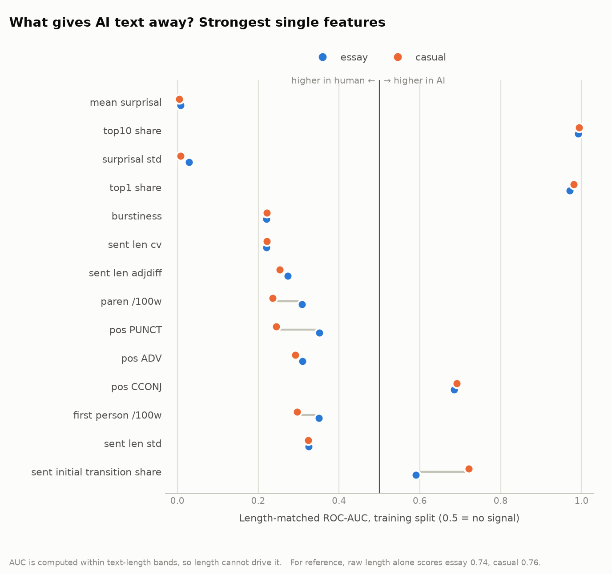
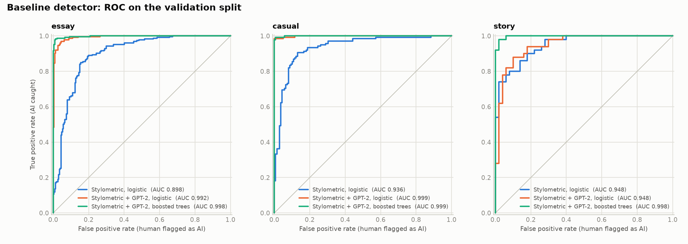
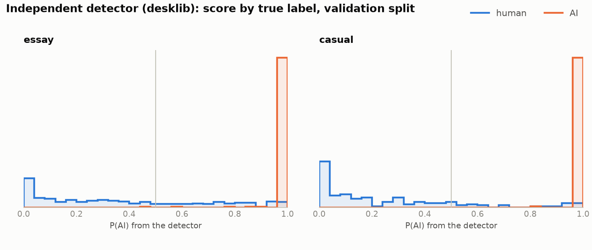
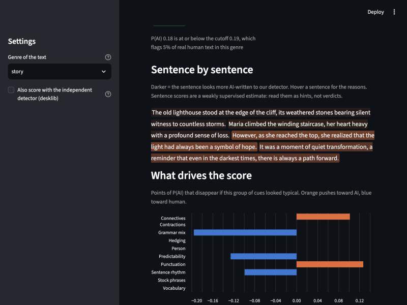

# Humanizer vs. Detector: an adversarial study of AI-written text

**Research question:** how well can AI-generated writing (especially stories) be rewritten to read as
human, and which linguistic features give AI text away?

## Results summary

**Final held-out result (test split, run once):** on 26 unseen AI stories of at most 400 words, the faithful humanizer removed our own
detector's flag on 88% of them, but desklib (never used to steer) still flags **88% (71-96%)** of the rewrites and fakespot 65% (46-81%).
Only **2 of 26 stories (8%; 95% interval 2-24%)** end with a rewrite that keeps the meaning and fools all three detectors.
Without the meaning guardrails it would be 5 of 26 (19%). The detectors themselves hold up on unseen prompts (AUC 0.995-1.000 on
stories; 2.6-4.2% of human text flagged, against the 5% design target). Full tables and what was not tested: `reports/FINDINGS.md` section 4.

The tables below are the validation-split development results the settings were chosen from. The experiments are small (one humanizer
model, short stories), so every rate carries a 95% interval.

"Flagged" means above the cutoff that flags 5% of real human text, fixed in advance for each detector. The headline
question is: **for what share of AI stories does the user end up with a rewrite that keeps the meaning (passes every
guardrail) and that neither detector flags?**

Stories of at most 400 words, validation split, humanizer `qwen3.8-27b`, `full` prompt, prompt v1 (`results/loop_reports/outcomes_story_val_full_qwen_v1_n34.md`):

| n = 34 stories | Own detector (steers the loop) | Independent detector, desklib (never steers) |
|---|---|---|
| Raw AI stories flagged | 97% (85-100%) | 100% (90-100%) |
| Flagged after the loop | 6% (2-19%) | **68% (51-81%)** |
| **Rewrite kept, passes guardrails, fools BOTH detectors** | **32% (19-49%)** (11 of 34) | |

Scored after the fact by a **third detector** (fakespot, which steered nothing): the same kept rewrites fool it on **44% (29-61%)** of stories, and
all three detectors at once on **8 of 34 (24%; 12-40%)**. Evasion transfers well: 80% of the rewrites that fool desklib also fool fakespot.

What we learned (details and limitations in `reports/FINDINGS.md`):

- **Fooling our own detector is easy and says little.** Changing only punctuation and sentence boundaries, with every content
  word untouched, drops our detector from 100% to 18% flagged but leaves desklib at 90% (`hd eval control`, 40 train stories).
  Beating the detector that steers you is not evidence of looking human; the independent detector is what counts.
- **Fooling desklib costs fidelity.** Across 100 rewrites, desklib's score tracks how much of the story survives
  (Spearman 0.73 with meaning similarity). Rewrites that keep over 0.90 similarity fool desklib 9% of the time; at 0.80-0.85, 61%;
  below 0.80 nearly always, but those fail the guardrails. Replayed over our attempts, "fools both" is about 30% at a meaning
  floor of 0.80, 15% at 0.85 and 6% at 0.88 or above (`results/frontier_story_replay_v1_v2dev.csv`).
- **"Make it sound human" alone does nothing** (naive prompt: 100% still flagged). The model family matters too: the same loop
  with `gpt-oss-20b` or `gpt-oss-120b` (the story generator's family) makes tiny edits (similarity 0.97) and fools neither detector.
- **On all 34 validation stories, every variant lands at roughly 15-25% fooling all three detectors.** v1: 8 of 34 (24%; 12-40%);
  v2 faithful: 5 of 34 (15%; 6-30%), but with more meaning kept (0.91 vs 0.87) and no lost numbers or names; strong mode, paired on the
  24 stories it completed: 4 of 24 against faithful's 4 of 24. A 4-of-12 versus 2-of-12 edge for strong on the development stories was noise.
- **Humanizer v2 (repair mode, two-sided feedback, number-and-name guard) did not measurably raise that 32%.** On 12 train
  stories it kept more meaning (0.90) and never lost a number, but fooled both detectors on 2 of 12 (5-45%); a further wording
  lever (v3) was tried and reverted (no effect, paired p = 0.68). With n = 12 these runs cannot rule out a small difference.
- **Letting desklib steer did not help the independent judge.** On 21 validation stories (the quota ended the run there), the steered
  v2 loop fooled desklib 9 times against 6 for the v1 baseline, but fooled fakespot, which never steers, 7 times against 11 (not
  significant, paired p = 0.34), at 2.2 times the cost. Evasion of a detector you steer on does not transfer.

First-pass comparison of prompt strategies (10 validation stories, `qwen3.8-27b`, prompt v1, before guardrails; still a pilot):

| Strategy | Ours flagged | desklib flagged | Passes guardrails | Meaning similarity |
|----------|--------------|-----------------|-------------------|--------------------|
| naive | 100% | 100% | 100% | 0.98 |
| feedback | 20% | 90% | 100% | 0.93 |
| craft | 0% | 0% | 10% | 0.78 |
| full | 0% | 30% | 40% | 0.81 |

## How it works

1. **Detector:** interpretable linguistic features + a simple classifier, with per-sentence explanations.
2. **Humanizer:** an LLM rewrites AI text, steered by the weaknesses the detector found.
3. **Adversarial loop:** rewrite, score, feed feedback back, repeat (capped).
4. **Honest evaluation:** rewrites are also scored by independent open-source detectors the humanizer was never
   optimized against (desklib, and fakespot as a judge that never steers anything).

## Setup

Requires [uv](https://docs.astral.sh/uv/) and Python 3.11+ (uv fetches it for you).

```bash
uv sync --all-extras     # everything: data, nlp (spaCy + model), ml (PyTorch), embed, llm, app (Streamlit)
uv run pytest -q         # run tests
uv run hd --version
```

**Always sync with `--all-extras`.** `uv sync` is exact: running it with fewer extras (or none) *uninstalls* the packages
of the extras you left out, which breaks the pipeline until you sync again (the wheels stay in uv's cache, so
restoring is quick and needs no download).

**More than one key (optional).** Groq's limits are per account (organization), so a second *key in the same account* adds nothing; a key
from a second account has its own pool (check the provider's terms before doing that). Put extra keys in `.env` as `GROQ_API_KEY_2`,
`GROQ_API_KEY_3`, ... (append with `>>`; `>` overwrites the file). When one key hits its rate or daily limit the call is retried on the next
one and the exhausted key is skipped until its retry time; an invalid key is reported by position, never silently skipped. Both keys serve the
same model, so results from all keys can be pooled. `uv run hd llm check` reports each key.

**LLM provider (free tier).** Story generation and the humanizer use a free [Groq](https://console.groq.com)
key (`llm.provider: groq` in `configs/default.yaml`; `anthropic` is also supported). Put it in a git-ignored
`.env` file in the project root containing the single line `GROQ_API_KEY=your-key` (never committed), or
export it in your shell. Then:

```bash
uv run hd llm check      # verifies the key and models, and shows your account's real rate limits
```

Free tiers meter tokens per minute and per day. Every call is cached, the client paces itself from the
provider's rate-limit headers, and batch jobs stop cleanly at a daily limit and resume where they left off.

## Project status

Built in small milestones, one commit each (see `git log`); per-milestone notes are in
`LEARNING.md`. Current: **M0-M8 done** (data, features, detector, humanizer, loop, evaluation, Streamlit app). The held-out test evaluation has run once (faithful mode, 26 stories); the write-up is in `reports/FINDINGS.md`. Still to do by hand: the commercial-detector check (`reports/manual_detector_log.md`). The free Groq tier allows only about 65 rewrites per model per day, which sets the size of the experiments.

## What gives AI text away? (preliminary, M2)



Univariate, **length-matched** AUC on the **training split** of the two genres with data so far
(essay and casual, human vs ChatGPT; stories arrive once the LLM-written stories are generated). Full table:
[results/feature_effects.csv](results/feature_effects.csv). Distributions:
[results/figures/feature_distributions.png](results/figures/feature_distributions.png).

- **GPT-2 predictability separates the classes almost perfectly** (AUC ~0.99 for the share of tokens in
  GPT-2's top-10 guesses), and it survives length matching. ChatGPT text is far more predictable to GPT-2
  than human text (mean surprisal 2.2 vs 3.6 nats).
- **Sentence rhythm is the strongest *interpretable* signal:** AI sentences are more uniform in length
  (burstiness AUC ~0.22, i.e. human text is burstier), in both genres.
- **AI uses fewer contractions and first-person words** (casual: contraction AUC 0.27) and **more
  sentence-initial transitions** (casual 0.71, essay 0.59).
- **Two hypotheses did not hold on this data:** em-dash rate (0.48) and my stock-phrase list (0.51) carry
  no signal. The AI side here is ChatGPT from December 2022, so this says little about today's models.
- **Caveat:** these are single-feature, training-split numbers. Length-banding reduces but does not fully
  remove the length confound (see `stratified_auc`). Held-out detector results arrive in M3.

## Baseline detector (M3)

Logistic regression and boosted trees on interpretable features. Hyperparameters are tuned by
prompt-grouped cross-validation on the train split; the numbers below are on the **validation split**
(730 texts, held out from training and tuning). The **test split is still locked** and is used once, in
the final evaluation. Positive class = AI; 95% intervals resample whole prompts.

| Detector | Accuracy | Precision | Recall | ROC-AUC (95% CI) | Length-matched AUC |
|---|---|---|---|---|---|
| Stylometric features, logistic | 0.860 | 0.842 | 0.888 | 0.915 (0.895-0.936) | 0.914 |
| + POS n-grams, logistic | 0.868 | 0.851 | 0.893 | 0.935 (0.918-0.952) | 0.937 |
| + GPT-2 predictability, logistic | 0.971 | 0.960 | 0.984 | 0.996 (0.992-0.998) | 0.999 |
| + GPT-2 predictability, boosted trees | 0.982 | 0.978 | 0.986 | 0.998 (0.996-0.999) | 0.998 |



Per-genre rows, confusion counts and train-vs-val gaps: [results/baseline_metrics.csv](results/baseline_metrics.csv);
confusion matrices: [results/figures/baseline_confusion.png](results/figures/baseline_confusion.png).

How to read this honestly:
- **The interpretable features alone reach ~0.92 AUC; GPT-2 predictability adds the rest (~0.996).**
  Burstiness-type, punctuation and transition features carry real signal without any neural model.
- **This is a detector for December-2022 ChatGPT (essay, casual), not for modern models.** Near-perfect
  scores here say the task is easy for *that* AI text. Whether it holds on LLM-written stories, and on
  rewrites designed to evade it, is exactly what M5-M7 measure.
- Boosted trees fit the training set perfectly (train accuracy 1.00) yet validate at 0.982, so the
  validation number, not the training number, is the one to quote.

## Using the detector, and the independent check (M4)

```bash
uv run hd detector train-sentence                    # once: fits the per-sentence model (~3 min)
uv run hd detect "paste a text here" --external      # or --file story.txt, or pipe via stdin
```

You get P(AI), which feature groups drove the score, and the most AI-like sentences with plain-language
reasons (predictable wording, stock transition opener, hedging, uniform length). Drivers use
*neutralization*: swap a feature group's values for typical ones and see how much P(AI) moves
(`+` = pushes toward AI). Sentence scores come from a small model on GPT-2 surprisal-in-context plus local
cues. Its labels are inherited from the document, so it ranks sentences within a text; it does not certify
any single sentence (validation sentence AUC 0.90, [results/sentence_metrics.csv](results/sentence_metrics.csv)).

**Independent detector:** [`desklib/ai-text-detector-v1.01`](https://huggingface.co/desklib/ai-text-detector-v1.01)
(DeBERTa-v3-large, MIT, trained on the RAID benchmark, not on our data). It is used only to *evaluate*;
nothing in this project is trained or tuned against it.



Validation split, raw human vs raw AI text ([results/external_metrics.csv](results/external_metrics.csv)):

| Detector | ROC-AUC | AI caught @0.5 | Human flagged @0.5 | AI caught @ 5% human flagged |
|---|---|---|---|---|
| Ours (boosted trees) | 0.998 | 98.6% | 2.2% | 98.9% |
| desklib (independent) | 0.996 | 99.7% | **25.8%** | 98.4% |

- **The independent detector ranks texts about as well as ours, but its default 0.5 cutoff is badly
  miscalibrated for this text:** it flags a quarter of human answers (a third of the essays) as AI.
- **So every later comparison uses a matched false-positive rate.** Each detector's cutoff is chosen on
  validation *human* texts to flag 5% of them ([results/detector_thresholds.json](results/detector_thresholds.json)),
  then frozen. Otherwise "humanized text is flagged less" could just mean "the detector over-flags everything".
- **Both detectors find raw ChatGPT-2022 text easy.** The meaningful test is rewritten text (M6-M7).
- **Anecdote, not a result:** on one hand-written paragraph mixing casual and stock-AI sentences, our
  detector said 0.002 and desklib 1.000. One example proves nothing, but it fits the concern that ours leans
  on GPT-2 predictability, which a few quirky specifics can move.

## Rewrite strength

`hd loop run --strength faithful|strong` (and a radio button in the app's Humanize tab) picks an operating point on the
fidelity-versus-evasion trade-off described above. It changes both what the prompt asks for and which guardrail limits apply:

| | Faithful (default) | Strong |
|---|---|---|
| Prompt | keep every sentence's content | may compress or drop minor descriptive detail, restructure freely, bolder rhythm |
| Meaning similarity at least | 0.80 | 0.72 |
| Dropped sentences at most | 20% | 30% |
| Numbers and names | must survive | must survive |
| Typos, reading level, length | same checks | same checks |

Strong mode should fool detectors more often because it keeps less of the original, and it changes more of your text. Whether it
does, and at what cost, is measured separately and never pooled with faithful results (every log records the strength).

## The app (M8)

```bash
uv run hd app            # same as: uv run streamlit run app/app.py
```



- **Detect:** paste text, get P(AI) and a verdict against the frozen 5%-false-positive cutoff, the text shaded sentence by
  sentence (hover for the reasons), a chart of which cue groups push the score toward AI or human, and the strongest
  individual cues. Optionally also scores with the independent detector (desklib, ~1.7 GB model on first use).
- **Humanize:** choose a prompt strategy, a Groq model and the maximum number of rewrites; the app runs the same adversarial
  loop as the experiments, shows what you would actually get (a rewrite that fails the guardrails is never presented as the
  result; rejected attempts sit in a warned expander), every attempt's scores and guardrail flags, and a rough token cost
  before you spend any of the free-tier quota. A **dry run** shows the exact prompt without calling any API.
- The app needs the trained models (`hd detector train-baseline`, `train-sentence`, `eval-external`) and, for Humanize, a
  `GROQ_API_KEY`. It never reads the held-out test split.

## Evaluation (M7)

```bash
uv run hd eval report --log <loop log> --features     # outcome tables with 95% intervals + figures (before/after, iterations, feature shift)
uv run hd eval ablate-prompts --genre story --model qwen/qwen3.8-27b --max-words 400
uv run hd eval ablate-features                          # detector AUC with each feature group dropped / on its own
uv run hd eval manual-kit --log <loop log> --n 5        # blind samples + log for testing commercial detectors by hand
uv run hd eval final --unlock-test                      # THE held-out test evaluation: runs once, every unlock is logged
```

Honesty rules built into the code: every rate has a Wilson interval (with a few dozen texts the interval is part of the
result); the loop reports both what a user would actually get (a failed rewrite is never credited as a success) and the
unguarded best rewrite; the independent detector never steers anything; the test split is opened only by `hd eval final`
and `hd loop run --split test --unlock-test`, each logged in `results/test_access_log.txt`, and the final evaluation refuses
to run twice without `--again`. Detector feature-group ablation (what gives AI text away) and all caveats are in
`reports/FINDINGS.md`.

## The humanizer (M5)

```bash
uv run hd humanize --file story.txt --dry-run     # shows the exact prompt; calls no API, needs no key
uv run hd humanize --file story.txt --external    # rewrite + before/after scores + guardrails (needs a key)
```

The humanizer asks an LLM (`openai/gpt-oss-120b` on Groq's free tier by default; `llama-3.3-70b-versatile` is no longer available to the key; use `--model` on `hd loop run` to choose another, e.g. `qwen/qwen3.8-27b`) to rewrite AI text. The prompt is assembled from
blocks, so M7 can ablate them: **naive** (just "make it sound human"), **craft** (+ genre-specific writing
techniques), **feedback** (+ what our detector found wrong with *this* draft) and **full** (all of it, plus
the most machine-like sentences called out). The feedback compares the draft with real human text of the
same genre and states the numbers, for example (a textbook AI lighthouse story, `--dry-run`):

> Sentence lengths are too uniform (variation 0.39; human story texts typically 0.62). Break the rhythm: put a few very short sentences or fragments next to long, winding ones.
> Stock connectives are overused (4 of 15 sentences open with one; found: 'however', 'moreover', 'furthermore', 'ultimately').
> Few contractions (0.0 per 100 words; human typically 1.4).

Every rewrite is checked by guardrails: meaning (sentence-embedding similarity, share of original sentences
dropped, share of rewrite sentences invented), length, Flesch-Kincaid readability before/after, and
typo/gibberish signals (new words that fragment into 3+ GPT-2 word pieces; an optional GPT-2 surprisal
ceiling). The prompt forbids typos and the guardrails look for them: nothing is "humanized" by injecting errors.

**Status, stated plainly:** no LLM key has been available yet, so the humanizer has only been run through a
mock client and `--dry-run`. Nothing here yet shows that real rewrites fool any detector. That is M6-M7.

How well do the guardrails work? Simulated failures on 150 real validation texts each
([results/guardrail_calibration.csv](results/guardrail_calibration.csv)); share flagged:

| Simulated "rewrite" | Flagged |
|---|---|
| Text unchanged (should never be flagged) | 0% |
| Unrelated text of the same genre | 100% |
| The human answer to the same prompt (same topic, different content) | 96% |
| 5% of long words misspelled | 75% |
| 30% of sentences swapped for sentences of other texts | 41% |
| 30% of sentences deleted | 51% (almost all from the length check; the content checks catch only 6%) |

**Limitation:** the guardrails reliably catch wholesale drift and typos, but only partly catch *modest*
content loss, and a rewrite that deletes sentences but keeps the length (padding elsewhere) would slip through. Sentences inside one story or answer are semantically close, so a missing sentence still has a
near neighbour in the embedding space.

**A guardrail changed after seeing real rewrites (disclosure).** The M5 reading-level rule ("the Flesch-Kincaid
grade may not move more than 3 levels") was calibrated only on synthetic corruptions. On real qwen rewrites it
rejected 8 of 10 stories, but AI stories read at grade ~8.3 and human stories at ~5.0, so lowering the grade is
exactly what humanizing does. It now requires the rewrite's grade to fall inside the range of real human text for
the genre (1st-99th percentile of *train-split* human texts; story: 2.2 to 11.0). With the old rule the same loop
ended with ours 80% / desklib 100% flagged and 20% of rewrites accepted (log kept as `..._fkdelta-rule.jsonl`).
The change was motivated by the pilot, so the final evaluation reports results under both rules. False-positive
rates of the other thresholds on genuine rewrites are still only partly measured.

## Data

```bash
uv sync --extra data --extra llm
uv run hd data download            # ~104 MB from Hugging Face into data/raw/
uv run hd data build               # clean, pair, split -> data/processed/corpus.parquet
uv run hd llm check                # key + limits (needs GROQ_API_KEY in .env)
uv run hd data generate-stories    # LLM stories for the 300 prompts (resumable; stops cleanly at a daily limit)
uv run hd data build               # rebuild so the new stories join the corpus
```

Detector (fits 5 variants, ~1 minute):

```bash
uv run hd detector train-baseline      # writes models/ (git-ignored) and results/baseline_*.csv + figures
```

Features (GPT-2 weights, ~0.55 GB, download on first use into the Hugging Face cache):

```bash
uv run hd features build      # ~3 minutes on an Apple-silicon Mac; cached by text id
uv run hd features analyze    # effect sizes + figures, training split only
```

Sources, licenses, cleaning and known confounds: [data/DATA_SOURCES.md](data/DATA_SOURCES.md).
Genres: story, essay, casual (email deferred). The test split is locked in code until final evaluation.

## Layout

`src/hd/` holds the code (data, features, detector, humanizer, loop, eval, cli), `app/` the
Streamlit UI, `tests/` the tests, `configs/default.yaml` all settings including the random seed (42).
